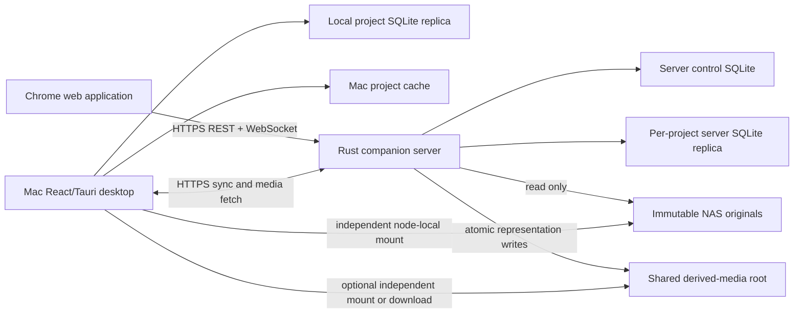
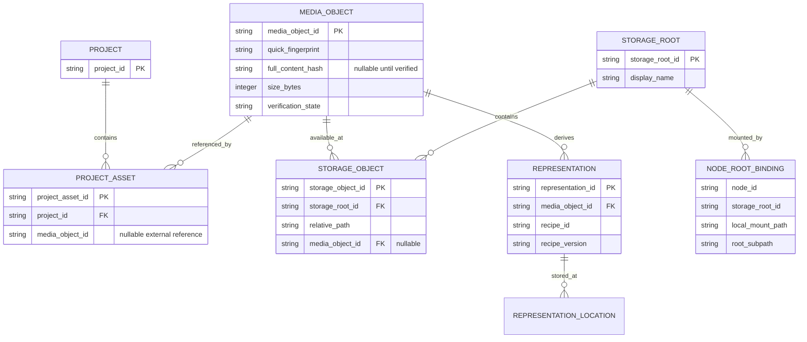
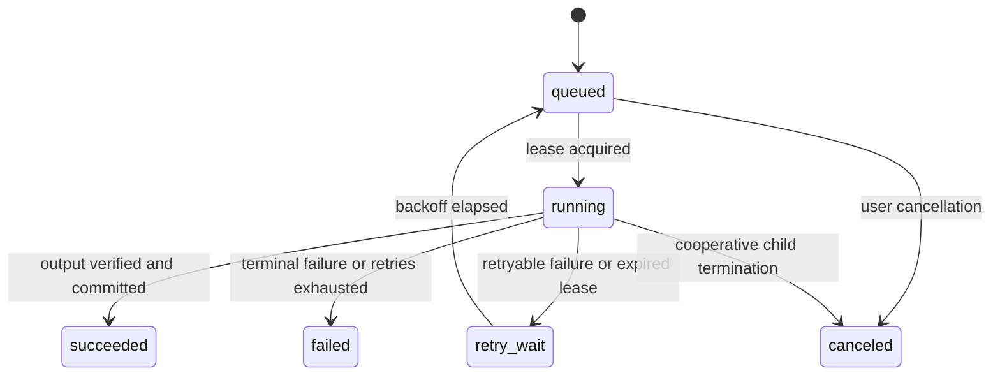
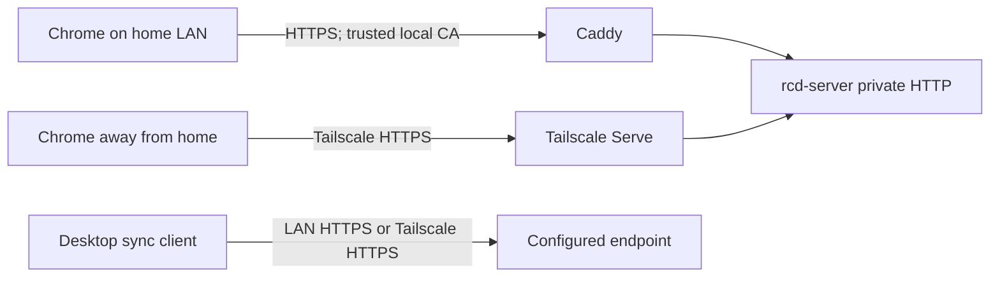

# Companion Server Architecture

**Status:** Accepted design for implementation planning
**Date:** 2026-07-20
**Scope:** First companion-server epic for RCD VlogCutter
**Target deployment:** One Ubuntu home-server laptop, one Mac desktop, one user, Chrome web client

## 1. Executive summary

RCD VlogCutter will become a two-node, local-first system:

- The Mac remains the primary interactive client and continues to work without a network connection.
- The Ubuntu server is the durable synchronization hub, global NAS media index, background processor, and web host.
- The web application is an online client of the server. It does not synchronize directly with the Mac and is not offline-first.
- Every desktop project has exactly one server replica. The relationship is analogous to a Git checkout and its configured origin, without treating either SQLite file as transferable repository state.
- The server also owns a global media library. Project assets are memberships of globally fingerprinted media, so one physical clip can be reused by multiple projects without sharing project annotations.
- The Mac and server may independently mount the same NAS at different paths. Shared storage is identified by a logical storage-root ID and root-relative paths; absolute mount paths remain node-local.
- SQLite files stay on local SSDs. Nodes exchange immutable domain operations, observations, and representation manifests over a versioned protocol. SQLite databases are never synchronized as files or opened across the network.
- Originals remain immutable. Server original-media mounts are read-only. Generated representations live in a dedicated derived-media root and optional local caches.

The first release includes NAS scanning, verified content identity, durable thumbnail and proxy jobs, project synchronization, web browsing and review, current annotation editing, job/storage administration, and operational diagnostics. It deliberately excludes AI analysis, transcription, web chronology editing, project deletion, automatic cleanup, bulk offline preparation, and archival transfer of originals.

## 2. Accepted product decisions

These decisions were confirmed for this epic and take precedence over older statements that cross-device synchronization and a Linux node are deferred:

1. One human user, one Mac, and one Ubuntu server are supported.
2. Each desktop project has exactly one durable server replica. Project creation remains a desktop action.
3. The server may independently scan configured NAS roots into a global asset library.
4. The web application may add a server-library media object to an existing replicated project.
5. Project annotations are project-scoped even when projects reference the same global media object.
6. Quick sampled fingerprints identify candidates. Independently discovered files are not permanently merged until a full-file BLAKE3 hash matches.
7. The server must work through both a direct home-LAN route and Tailscale while away.
8. Chrome is the supported browser for the first release.
9. Tailscale HTTPS is the remote route. Direct LAN access also uses HTTPS and application credentials.
10. A project asset may synchronize to the Mac while its original is remote-only. Metadata and thumbnails remain useful, and a compatible server proxy can be downloaded on demand.
11. The server runs on an Intel i7-8550U Ubuntu laptop with 16 GB RAM and local SSD storage. Defaults must be conservative enough for that machine.
12. The final implementation task updates all repository documentation after behavior is complete and verified.

## 3. Goals

### 3.1 User goals

- Leave the Mac asleep while the server scans NAS media and generates review representations.
- See the same project annotations on the desktop and web without making desktop saves depend on the server.
- Browse the NAS archive before deciding which clips belong in a project.
- Add archived media to an existing project from Chrome.
- Review server-hosted proxies, edit notes and labels, and remove or restore clips from Chrome.
- Understand whether an original or proxy is available on the Mac, server, shared derived store, or nowhere currently accessible.
- Reconnect after travel and reconcile changes automatically, with conflicts surfaced when silent resolution would be unsafe.
- Operate and recover the service without editing SQLite by hand.

### 3.2 Engineering goals

- Preserve the Rust core as the owner of domain behavior.
- Preserve portable project catalogs and current offline desktop behavior.
- Use explicit, versioned synchronization contracts rather than table replication.
- Keep server databases, job state, and authentication state on the server SSD.
- Make scans, media work, and synchronization idempotent and restart-safe.
- Keep original-media access read-only at both application and deployment boundaries.
- Support thousands of clips and approximately 100 hours per project with paginated APIs and bounded UI/media resources.
- Make important state observable through stable JSON diagnostics.

## 4. Non-goals for this epic

- More than one Mac, more than one server, or more than one user
- Peer-to-peer synchronization or server migration
- Offline browser behavior or a CRDT-backed browser store
- Public Internet exposure or Tailscale Funnel
- Project creation or deletion from the web
- Original upload, archive transfer, deletion, rename, or automatic cleanup
- A competitive distributed worker pool
- Durable Mac-local jobs; the server may retain a pending request for the Mac, but the Mac continues to execute its current media operations locally
- Web chronology calibration or chronology conflict resolution UI
- Trip-context, event, chapter, script, edit-plan, or Resolve-export features
- Contact sheets beyond the current quality-1 thumbnail representation
- Transcription, VLM analysis, embeddings, semantic search, or automatic clock inference
- Hardware transcoding in the initial implementation
- General-purpose multi-tenant authentication and authorization

## 5. System context



The server is an origin-like hub, not a mandatory backend for desktop interaction. The browser is a thin online surface over server state. The NAS stores media, not live SQLite databases.

## 6. Authority and ownership

Authority is divided by kind of state rather than by declaring one machine authoritative for everything.

| State | Owner or authority | Replication behavior |
| --- | --- | --- |
| Project identity | Created by desktop; registered by server | Same stable `projectId` on both replicas |
| Human project decisions | Neither node exclusively | Immutable operations reconcile through server |
| Server global media library | Server | Project-linked projection is sent to Mac |
| Server storage availability | Server observation | Server replaces its own observation generation |
| Mac storage availability | Mac observation | Mac replaces its own observation generation |
| Absolute mount binding | The node that uses it | Never used as another node's canonical path |
| Derived representation | Immutable content/recipe result | Manifests merge; blobs transfer explicitly |
| Durable server jobs | Server | Web/Desktop observe; server executes and recovers |
| Desktop transient media work | Mac | Current local execution; result manifest may sync |
| Browser UI state | Browser session | Not synchronized |

The server acknowledges a project operation only after it and its materialized result are committed. Once acknowledged, the server is the durable rendezvous for that operation. The Mac nevertheless retains its complete local project replica and remains usable if the server is lost or unavailable.

## 7. Identity model

The architecture separates content identity, physical storage, and project membership.

### 7.1 Stable identifiers

| Identifier | Meaning |
| --- | --- |
| `nodeId` | Stable installation identity for the Mac or server |
| `projectId` | Stable project identity created on the desktop |
| `projectAssetId` | Membership of one media object in one project |
| `mediaObjectId` | Server-library identity for verified media content |
| `storageRootId` | Logical storage root shared across node-specific mounts |
| `storageObjectId` | One root-relative physical file observation |
| `representationId` | Immutable output identity for content plus recipe |
| `operationId` | Globally unique immutable project operation |
| `jobId` | Durable server or node-targeted work request |

Existing `project_*` and `asset_*` IDs remain valid. Migration must add identities and links without rewriting them.

### 7.2 Media and project relationship



`ProjectAsset` owns notes, labels, removal, rotation, chronology participation, and any later edit-planning state. `MediaObject` owns content identity and reusable technical facts. Sharing a `MediaObject` never shares project annotations.

### 7.3 Two-stage content identity

1. Compute the current sampled BLAKE3 fingerprint and file size for fast candidate discovery.
2. Mark the candidate identity `provisional`.
3. Schedule a full-file BLAKE3 job.
4. Record file size and modification metadata before and after hashing; discard the result if the file changed during the read.
5. Merge independently discovered candidates only when full hashes and sizes match.
6. Keep mismatches separate and surface a diagnostic warning.

The same logical `storageRootId` plus normalized relative path represents the same physical storage object across nodes. A node still verifies size and quick fingerprint when it can access the path. Files on different storage roots require full-hash equality before being permanently treated as the same media object.

Representations may be generated while identity is provisional, but they cannot be reused across projects or nodes as verified equivalents until the full content hash is available.

## 8. Storage-root and path model

### 8.1 Logical root plus node-local binding

An asset path is represented as:

```text
storageRootId + relativePath
```

Each node separately stores:

```text
nodeId + storageRootId + localMountPath + optionalRootSubpath
```

Example:

```text
Logical object:
main-nas-video / Trips/2025/Argentina/Sony/C0103.MP4

Mac binding:
/Volumes/TravelNAS + Trips/2025/Argentina/Sony/C0103.MP4

Server binding:
/mnt/rcdvlog/originals + Trips/2025/Argentina/Sony/C0103.MP4
```

Absolute paths are local configuration. A node may synchronize that it has a usable binding and its access capability, but other nodes never resolve media using the reported absolute path.

### 8.2 Root association

RCD VlogCutter does not write marker files into original-media trees. Root association uses:

- Explicit user selection
- Matching root-relative paths
- Sampled fingerprint and size evidence
- Full-hash evidence where needed
- Persisted node-local association

The pairing UI shows its evidence and requires confirmation before declaring two mounts the same logical root. Partial mounts use `rootSubpath` and expose only the matching subtree.

### 8.3 Path safety

- Relative paths must be normalized Unicode strings with `/` as the protocol separator.
- Absolute paths, empty components, `.` and `..` traversal, and NUL bytes are rejected.
- Resolution canonicalizes the binding and candidate path and verifies containment.
- Scans do not follow symlinks.
- A resolved symlink or mount escape is rejected even if the lexical path appears contained.
- External tool arguments use structured `Command` arguments, never shell interpolation.

### 8.4 NAS mounting

NFS is the recommended Ubuntu mount when the NAS supports it; SMB remains supported because storage identity is independent of protocol. The host mounts storage before Docker starts:

- Original roots: host mount read-only where practical and Docker bind mount `ro` unconditionally.
- Shared derived root: separate read-write mount.
- Server database and temporary working directory: local SSD, never NAS.
- Backup root: configurable, preferably a distinct writable NAS directory.

Unavailable mounts cause jobs to remain pending or fail with a retryable `media_offline` condition. They never cause a scan to infer deletion immediately.

## 9. Persistence topology

### 9.1 Mac

Each existing project catalog remains in its current project folder. New forward migrations add:

- Formal schema version history
- Replica/node metadata
- Project operation log and per-origin cursors
- Materialized field revisions
- Note revisions
- Label add/remove state
- Storage-root references and node-local bindings
- Media-object link and verification state
- Representation manifests and locations

Existing absolute `assets.path`, `proxy_path`, and thumbnail rows remain available during migration. New code projects them into the new model and only retires legacy columns through a later, separately planned migration.

The desktop's global application settings store the paired server ID, endpoint aliases, and non-secret configuration. Device credentials go in the macOS Keychain, not the settings JSON or project catalog.

### 9.2 Server control catalog

`/var/lib/rcdvlog/control.sqlite3` stores server-wide state:

- Server/node identity
- Authentication credential metadata and browser sessions
- Project registry and replica locations
- Storage roots and server bindings
- Global media objects and storage objects
- Technical media facts
- Representations and representation locations
- Durable jobs, attempts, schedules, leases, and rate history
- Server observation generations
- Backup manifests and operational metadata

### 9.3 Server project replicas

Each project has an independent replica:

```text
/var/lib/rcdvlog/projects/<projectId>/catalog.sqlite3
```

The replication unit is `projectId`, not a desktop file path. A legacy desktop catalog containing multiple projects can pair each project independently without copying the entire legacy database.

Server project replicas use the same domain schema and operation semantics as desktop catalogs. Server-only control and library state does not leak into the portable project catalog.

### 9.4 SQLite rules

- All live SQLite databases reside on the node's local SSD.
- WAL and foreign keys are enabled, with bounded busy timeouts.
- The application owns every connection; the browser and other nodes never access a database file.
- Schema changes use numbered, transactional forward migrations recorded in `schema_migrations`.
- Upgrade tests start from checked-in older-schema fixtures.
- No implementation or recovery step deletes a catalog to resolve migration problems.

### 9.5 Consistency across server databases

Project replicas and the control catalog are deliberately separate SQLite databases. A relationship such as `ProjectAsset.mediaObjectId` is therefore an application-validated external reference, not a cross-database SQLite foreign key.

The system does not depend on a transaction spanning attached databases:

- A project operation and its materialized project state commit first in the project replica.
- Control-catalog membership indexes are rebuildable projections keyed by `projectId`, `projectAssetId`, and the source operation ID.
- An idempotent projection worker applies or repairs those indexes after the project commit.
- Library queries may briefly report projection lag but cannot invent or lose project membership.
- Representation/project projections use the same durable-source-plus-idempotent-projection pattern.
- Baseline replicas are built and verified at an unregistered temporary path. Registration makes them visible; orphaned verified imports are discoverable and safe to resume or quarantine.

This avoids relying on cross-file atomicity in WAL mode while preserving a clear source of truth for recovery.

## 10. Project operation model

Human-authored project state synchronizes as immutable, typed operations. An operation contains:

```json
{
  "operationId": "op_uuidv7",
  "projectId": "project_123",
  "originNodeId": "node_mac",
  "originSequence": 4182,
  "logicalTime": {
    "wallMillis": 1784568257351,
    "counter": 3,
    "nodeId": "node_mac"
  },
  "aggregateType": "projectAsset",
  "aggregateId": "asset_123",
  "operationType": "noteRevisionCreated",
  "payloadVersion": 1,
  "baseRevision": 7,
  "payload": {
    "revisionId": "note_456",
    "text": "Breakfast before leaving the hotel."
  }
}
```

Requirements:

- `(originNodeId, originSequence)` is unique and monotonically allocated in the same transaction as the local mutation.
- `operationId` is globally unique and time-sortable.
- The hybrid logical clock supplies deterministic ordering without trusting synchronized wall clocks.
- `payloadVersion` permits additive protocol evolution.
- Applying an operation and updating its materialized view occurs in one SQLite transaction.
- Reapplying an operation is a no-op.
- Invalid operations are rejected as a whole; partial materialization is forbidden.
- The complete MVP operation history is retained.

Domain commands, not arbitrary table patches, create operations. Desktop, server web, and CLI adapters call the same Rust commands. The existing full `AssetPatch` boundary is migrated to explicit note, label, removal, and rotation commands; compatibility adapters may compute a diff but may not directly update materialized columns.

Desktop ingest remains local and reference-in-place. Each successfully imported file creates a `projectAssetAdded` operation containing its project asset ID, quick identity, technical metadata, and logical location when mapped. After reconciliation, the server links or provisionally registers the global media object and emits a server-origin `projectAssetMediaLinked` operation. A Mac-only file may remain provisional indefinitely; it is not merged with a different storage object or reused globally until full-hash evidence exists.

## 11. Synchronization classes

### 11.1 Human project operations

Includes project asset membership, note revisions, label changes, removal, rotation, and current fixed clock events. These use the immutable operation log.

### 11.2 Node observations

Includes accessible storage roots, observed files, last verification, and node-relative availability. A node publishes a generation with a monotonic sequence. A new completed generation supersedes that node's prior observations for the scanned scope. One node never marks another node's location missing.

### 11.3 Derived representation manifests

Representation identity and completed locations are immutable facts. Job progress is not a representation fact. A manifest becomes visible only after output validation and atomic commit.

### 11.4 Media blobs

Originals never transfer in this epic. Server proxies and thumbnails are served to Chrome. The Mac may download a selected compatible proxy or thumbnail into its project-local cache. Bulk pinning and “Prepare offline” are deferred.

### 11.5 Ephemeral state

Window state, playhead, search text, hover, panel expansion, and job-console visibility do not synchronize.

## 12. Synchronization protocol

### 12.1 Topology

Only the Mac initiates desktop synchronization. The server never opens a connection to the Mac. Browser mutations become server-origin operations. The server is the rendezvous for the two operation origins: Mac and server.

### 12.2 Initial adoption

1. The desktop migrates the selected catalog without changing current user-visible state.
2. A pairing preview reports the project identity, asset count, annotation count, legacy paths, proposed storage-root mappings, candidate global-library matches, and conflicts.
3. The user confirms the server, project, and root associations.
4. The desktop creates a versioned project baseline snapshot and digest.
5. The server imports the snapshot transactionally into a new temporary replica.
6. The server links assets to existing global media objects provisionally or verifies full hashes as necessary.
7. The server atomically registers the replica and returns its baseline watermark.
8. The desktop records the pairing only after the server acknowledges the complete baseline.

Baseline import never overwrites an existing server replica. An interrupted import is safe to retry by baseline ID and digest.

### 12.3 Incremental reconciliation

The Mac sends:

- Protocol and project-schema compatibility range
- Project/server/node identities
- Highest contiguous sequence received for every known origin
- A bounded batch of locally originated operations not yet acknowledged
- New node observations and representation manifests

The server transactionally appends and materializes valid input, then returns:

- Highest contiguous Mac sequence committed by the server
- Bounded missing server-origin operations
- Updated server observation/representation cursors
- Conflict and compatibility notices
- Whether more pages are available

The client repeats until both sides report the same cursor set. Batches have count and byte limits. Retries reuse operation IDs and are idempotent.

### 12.4 Live updates

A WebSocket sends authenticated hints such as `projectAdvanced`, `jobUpdated`, and `representationAvailable`. It does not carry the only copy of state. Disconnect, missed messages, and process restart are recovered by the HTTP reconciliation protocol and periodic polling.

### 12.5 Compatibility

Every request declares protocol major/minor and relevant schema version. A compatible additive minor version may proceed. A major mismatch pauses synchronization with an actionable error while leaving desktop local work available. Unknown operation or payload versions are never silently ignored.

## 13. Conflict semantics

| Domain | Rule |
| --- | --- |
| Notes | Preserve immutable revisions; latest deterministic revision becomes active; history remains diagnostic-only in the first UI |
| Labels | Add-wins observed-remove set; removing a label removes only add-tags observed by that operation |
| `removed` | Hybrid-logical last-write-wins register |
| Rotation | Hybrid-logical last-write-wins register after right-angle validation |
| Project asset addition | Idempotent by `projectAssetId`; no asset deletion in this epic |
| Simple future scalar | Hybrid-logical last-write-wins unless the domain specifies otherwise |
| Clock events | Base-revision checked; incompatible concurrent aggregate changes create an explicit unresolved conflict |
| Storage locations | Merge observations; each node controls only its own availability generation |
| Representations | Merge by verified input content and recipe identity |
| Jobs | Immutable result identity; duplicate requests share or reuse idempotent work |

An unresolved clock conflict does not silently recalculate chronology from one winner. Because the web cannot edit chronology in this epic, the initial UI only needs to report such a conflict and direct the user to the desktop or CLI for resolution.

## 14. Global media library

The server library is independent from projects and supports:

- Configured logical storage roots and server mount bindings
- Manual and scheduled incremental scans
- Paginated browse and filter
- Technical metadata and verification state
- Multiple storage objects per media object
- Project membership counts
- Explicit “Add to project” for an existing replicated project

Adding library media to a project is a server-origin domain operation. It creates a stable project asset with a self-contained metadata projection and media-object link. The Mac can materialize it without accessing the original. If the Mac later binds the same logical root, availability resolves locally without changing project identity.

The reverse path is also supported: a project asset ingested on the desktop synchronizes first as project membership, then the server associates it with an existing or provisional library media object. Library association is allowed to lag project synchronization and is repaired idempotently.

No automatic project membership is inferred from a scan.

## 15. Durable job architecture

### 15.1 State machine



Jobs store type, target node, project/media input, requirements, recipe, idempotency key, priority, progress, retry policy, lease, cancellation state, timestamps, and structured error details. Attempts and successful output identities are separate records.

### 15.2 Server worker defaults

For the i7-8550U/16 GB server:

- One FFmpeg proxy worker
- One full-file hash worker
- Up to two lightweight probe/thumbnail/scan workers, configurable
- No hardware acceleration initially
- Weighted ETA history keyed by node, job kind, and versioned recipe

Worker limits are configuration with conservative defaults. A scan can enqueue work incrementally and must not retain the entire archive in memory.

### 15.3 Recovery and cancellation

- Workers acquire expiring leases and heartbeat while active.
- Startup requeues expired jobs without losing completed representation facts.
- Idempotency keys prevent duplicate output work.
- Cancellation first requests graceful child termination and then uses a bounded forced termination.
- Per-file failures do not abort otherwise recoverable scans or batches.
- A result is committed only after tool success, media validation, and atomic rename.

### 15.4 Node-targeted requests

If an original exists only on the Mac, the server may retain a pending Mac-targeted request. The Mac receives it during synchronization, executes through the existing local Rust media operation when the file is available, and reports the resulting manifest. The server remains responsible for retrying or canceling the request; this does not introduce a general durable Mac worker pool.

## 16. Representation architecture

### 16.1 Identity

```text
representationId = hash(
    verified full content hash,
    representation kind,
    recipe ID,
    recipe version,
    relevant tool/settings identity
)
```

The initial recipes remain compatible with current outputs:

- `proxy.h264-720p.orientation-v3`
- `thumbnail.q1.orientation-v2`

Existing valid project-local representations can be registered as local locations. They are reusable globally only after their source media identity and output contract are verified.

### 16.2 Storage

The shared derived root uses deterministic paths similar to:

```text
representations/<contentHash>/<recipeId>/<recipeVersion>/<representationId>.<ext>
```

Server jobs stage temporary output on an appropriate local or same-filesystem temporary path, validate it, and atomically commit. The Mac retains its existing project-local hot cache. A manifest may therefore have shared-NAS, server-local staging/cache, and Mac-local locations without treating them as different representations.

### 16.3 Browser and desktop delivery

- Chrome receives authenticated byte-range responses with correct media type, length, ETag, cache policy, and `206` semantics.
- Thumbnails use authenticated immutable URLs or API fetches without exposing filesystem paths.
- The desktop downloads an explicitly requested server proxy into its local project cache before normal local playback. Bulk pinning and space planning are deferred.
- Original files are not served to browsers in this epic.

## 17. Server API

The server exposes a versioned, same-origin JSON API and WebSocket. A Rust HTTP stack such as Axum/Tokio is appropriate, but transport code remains a thin adapter over core and server-domain services.

### 17.1 Resource groups

- `/api/v1/health` and `/api/v1/ready`
- `/api/v1/bootstrap`, `/api/v1/sessions`, and `/api/v1/devices`
- `/api/v1/projects` and project-scoped assets/operations
- `/api/v1/library/media`
- `/api/v1/storage-roots` and bindings
- `/api/v1/jobs` and schedules
- `/api/v1/representations` and authenticated media content
- `/api/v1/sync/projects/{projectId}/baseline`
- `/api/v1/sync/projects/{projectId}/reconcile`
- `/api/v1/events` WebSocket

### 17.2 Contract rules

- REST commands express domain intent; no generic row update endpoint exists.
- JSON DTOs use camelCase and stable string error codes.
- Responses include a request ID; logs use the same ID.
- Collections use cursor pagination and explicit limits.
- Mutation requests accept idempotency keys where retries are expected.
- Optimistic commands carry base revisions where the domain needs stale-write detection.
- The OpenAPI document is generated or checked from Rust-owned contracts and committed for TypeScript client generation.
- API compatibility and schema-generation checks run in CI.

## 18. Frontend architecture

### 18.1 Shared client seam

React components depend on a common service interface rather than Tauri or HTTP directly:

```ts
interface ProjectClient {
  getProject(projectId: string): Promise<Project>;
  listAssets(input: AssetQuery): Promise<AssetPage>;
  reviseNote(input: ReviseNoteCommand): Promise<ProjectAsset>;
  addLabel(input: LabelCommand): Promise<ProjectAsset>;
  removeLabel(input: LabelCommand): Promise<ProjectAsset>;
  setRemoved(input: SetRemovedCommand): Promise<ProjectAsset>;
  requestRepresentation(input: RepresentationRequest): Promise<Job>;
}
```

- `TauriProjectClient` calls the desktop API boundary.
- `HttpProjectClient` calls the server API.
- Components never call Tauri `invoke` or `fetch` directly.

### 18.2 Repository direction

```text
apps/
├── desktop/                 existing Tauri + React app
├── server/                  Rust server binary
└── web/                     Chrome-targeted Vite React app

core/
├── rcdvlog-core/            shared domain, project catalog, media primitives
├── rcdvlog-sync/            protocol and reconciliation logic
└── rcdvlog-server/          global library, jobs, representations, server orchestration

packages/
├── project-client/          TypeScript client interface and shared DTO projection
└── review-ui/               extracted reusable review components

deploy/server/
├── compose.yaml
├── Caddyfile
└── example.env
```

This is an incremental direction, not a big-bang rewrite. Extract shared interfaces and components only when the web surface consumes them. Keep domain behavior in Rust.

### 18.3 Web scope

The Chrome web application provides:

- Bootstrap/login session
- Project list and project asset browse
- Global library browse, verification state, and add-to-project
- Search and filters over current indexed fields
- Thumbnail and proxy review
- Note revision, label add/remove, remove/restore, and rotation display
- Availability by capability and node
- Storage-root, scan schedule, job, credential, and sync administration
- Explicit error and empty/offline states

It does not copy the desktop's three-column shell wholesale. It uses a responsive server-oriented shell and extracted review components. Desktop keyboard behavior must not regress as components are shared.

## 19. Authentication and network security

### 19.1 Application credentials

- First boot creates a short-lived, one-time bootstrap code visible only through a local server command or console.
- The browser exchanges it for an HttpOnly, Secure, SameSite session plus CSRF protection.
- The desktop exchanges a pairing code for a separately revocable device credential stored in macOS Keychain.
- Credential verifiers are salted and hashed in the control database; plaintext tokens are shown once.
- Sessions and device credentials can be listed and revoked.
- There is no username/password account database.
- Tailscale identity may be recorded for diagnostics but is not the sole application authorization check.

### 19.2 Two HTTPS front doors



- Caddy terminates LAN HTTPS using an internal CA and configurable local hostname. The installation flow exports and installs the CA certificate on the Mac/Chrome trust store.
- Tailscale Serve exposes the loopback backend privately within the tailnet and supplies the remote HTTPS certificate.
- The backend is published only on loopback and the private Compose network.
- Tailscale Funnel is never configured.
- Direct plaintext LAN service is disabled by default and cannot carry browser/device credentials.
- Host, origin, forwarded-header, and proxy allowlists distinguish the two trusted entry points.

### 19.3 Additional controls

- Same-origin web deployment; no wildcard CORS
- CSRF tokens on cookie-authenticated mutations
- Content Security Policy and secure response headers
- Rate limits on bootstrap/session endpoints
- Request/body/batch size limits
- Authenticated media URLs without secrets in query strings
- Strict path containment and no arbitrary-file endpoint
- Secrets excluded from logs and diagnostic bundles
- Original mounts read-only in Compose even if the host mount is writable

## 20. Deployment

The supported deployment is Docker Compose on the Ubuntu laptop:

- `rcd-server`: Rust API, static web assets, scheduler, and workers
- `caddy`: LAN TLS reverse proxy
- Host Tailscale daemon and Serve configuration
- Host-mounted NFS preferred, SMB supported
- Persistent local-SSD volume for `/var/lib/rcdvlog`
- Read-only original bind mounts
- Read-write derived and backup mounts

The server process does not require Internet access during ordinary work. Tailscale itself requires its normal network control path for remote connectivity, but LAN operation, local media work, and project state remain functional if Tailscale is unavailable.

Deployment configuration declares every allowed root rather than accepting arbitrary paths from API callers. Root changes require an authenticated administrative command and validation.

## 21. Backup and recovery

### 21.1 Backups

- Default schedule: 14 daily backups and 8 weekly backups, configurable.
- Recommended destination: a dedicated writable NAS backup root distinct from originals and derived media.
- Use SQLite's online backup API or an equivalent consistent snapshot operation; never copy a live database file without its WAL state.
- Back up the control catalog and each project replica with a manifest, schema version, cursor watermark, size, and checksum.
- Run `integrity_check` against completed backups before marking success.
- Exclude reproducible representation blobs by default; retain their manifests.
- Never include plaintext bootstrap codes or device tokens.

### 21.2 Restore

Restore is an explicit offline administrative command. It validates the backup, writes to a new path, and requires confirmation before changing the configured active catalog. It never deletes or overwrites the only existing copy automatically.

Recovery priorities:

1. Restore server databases from backup.
2. If a project replica is missing, reseed it from the paired Mac after comparing IDs and cursors.
3. Rebuild the global media library by rescanning if necessary.
4. Regenerate derived media from available originals.

## 22. Failure behavior

| Failure | Expected behavior |
| --- | --- |
| Server offline | Desktop mutations continue locally and accumulate in its operation log |
| Mac offline | Web/server work continues; Mac-targeted requests remain pending |
| NAS unavailable | Known assets remain in catalogs; availability changes; jobs wait or fail retryably |
| Tailscale unavailable at home | LAN HTTPS remains usable |
| LAN unavailable away | Tailscale route remains usable |
| WebSocket disconnect | UI polls/reconciles; no state loss |
| Server restart during job | Expired lease requeues; valid committed outputs are reused |
| Sync retry after timeout | Idempotent operation and baseline IDs prevent duplicates |
| Full hash mismatch | Candidates remain separate; warning is visible |
| Protocol mismatch | Sync pauses with explicit upgrade guidance; desktop local work continues |
| Corrupt backup | Backup is rejected and active data remains untouched |

Transient absence is never treated as permission to delete state or media.

## 23. Observability and agent access

The server emits structured JSON logs with request, project, job, and operation IDs. It provides:

- Liveness and readiness endpoints
- Job queue depth, lease, retry, throughput, and ETA diagnostics
- Project sync cursors, last success, pending operations, compatibility, and conflicts
- Storage-root mount and containment diagnostics
- Media identity and verification evidence
- Representation recipe, validation, and location diagnostics
- Backup status and last verified restore point
- Redacted diagnostic bundle generation

The CLI remains the machine-readable agent surface. New read commands must be strictly read-only and must not run migrations, scans, hashing, or repairs. Mutations such as pairing, scan launch, retry, credential revocation, backup, and restore are separately named commands with stable JSON envelopes.

MCP remains deferred.

## 24. Performance and resource constraints

- All library/project collections are cursor-paginated and indexed for their sort/filter keys.
- APIs never serialize an entire multi-thousand-asset project by default.
- Scans enqueue incrementally and bound open file handles and memory.
- Full hashing and FFmpeg have separate one-worker defaults to avoid saturating the four-core mobile CPU and NAS.
- Browser asset lists virtualize or page rather than rendering all clips.
- Video delivery supports range requests and does not buffer entire proxies in Rust memory.
- SQLite write transactions remain short; media processes never run inside a transaction.
- WAL checkpoints and database sizes are observable.
- Task-key rate history remains versioned by recipe and node so Mac and server performance are not mixed.

Scale acceptance uses thousands of synthetic catalog entries plus a small real-media fixture. The known Expo source tree is manual, read-only acceptance only.

## 25. Verification strategy

### 25.1 Automated

- Forward migration and older-catalog upgrade tests
- Domain-operation unit and property tests for idempotency and convergence
- Label observed-remove and HLC ordering tests
- Note history and clock conflict tests
- Two independent temporary SQLite replicas reconciling after offline edits
- Baseline interruption and retry tests
- Auth, CSRF, credential revocation, origin, and path-traversal tests
- Durable job lease/restart/cancel/retry tests
- Real FFmpeg/ffprobe proxy, thumbnail, validation, and range-response tests
- Server-library scan, quick/full hash, collision/mismatch, and move/rescan tests
- Chrome Playwright flows for library, project review, annotations, jobs, and sync status
- Docker Compose smoke test on Linux CI where available
- CLI JSON contract and read-only diagnostic tests

### 25.2 Manual

- Ubuntu laptop reboot and service recovery
- NFS and, if needed, SMB mounting
- Caddy CA trust and direct LAN Chrome access
- Tailscale Serve access away from LAN
- Mac working offline, reconnecting through LAN, then reconnecting through Tailscale
- Same NAS root mounted at different Mac/Linux paths
- NAS disconnect/reconnect during scan, hash, and proxy work
- Original-root write denial from inside the container
- Chrome proxy playback and seeking
- Server backup and restore drill using disposable copies
- Resource and thermal behavior during a large proxy batch

## 26. Delivery sequence

1. Add schema/version and shared domain foundations.
2. Establish the server runtime and local control catalog.
3. Implement logical storage roots and the global library.
4. Add the durable server job engine.
5. Implement scans and verified content identity.
6. Add shared representations and authenticated media delivery.
7. Convert current mutations to operation-backed domain commands.
8. Implement project baseline and incremental synchronization.
9. Secure both LAN and Tailscale transports.
10. Add desktop pairing, automatic sync, conflicts, and proxy fetch.
11. Add the Chrome web application and shared review surfaces.
12. Add operational controls, backups, diagnostics, and acceptance coverage.
13. Update all documentation to describe implemented behavior accurately.

The detailed dependency order and acceptance criteria are in [EPIC.md](EPIC.md) and the numbered task files.

## 27. Deferred evolution

The following extensions fit the architecture without being preimplemented:

- A second Mac adds another operation origin and node binding.
- Durable Mac workers replace the minimal node-targeted request adapter.
- “Prepare offline” becomes a representation selection, sizing, pinning, and transfer plan.
- “Archive to home” adds explicit original copy, full-hash verification, and separately authorized cleanup.
- Web chronology adds revision-aware commands and a dedicated conflict resolver.
- Trip context, scripts, and edit plans add new project operations and immutable revisions.
- Transcription/VLM jobs add versioned recipes and representations without changing project synchronization fundamentals.
- A CRDT may later back rich collaborative documents while the domain operation log remains the contract for assets, chronology, and jobs.

## 28. Sources and rationale

- [SQLite WAL documentation](https://sqlite.org/wal.html) explains why WAL participants must be on one host and why database files are not a cross-node synchronization mechanism.
- [SQLite `VACUUM INTO` documentation](https://sqlite.org/lang_vacuum.html) describes one supported way to create a consistent live-database copy; implementation may instead use the online backup API.
- [Tailscale Serve documentation](https://tailscale.com/docs/features/tailscale-serve) documents private tailnet HTTPS proxying to a loopback service and the trust boundary for forwarded identity headers.
- [Caddy automatic HTTPS documentation](https://caddyserver.com/docs/automatic-https) documents internal/local certificates and the requirement to trust the generated CA on client devices.
- [Docker bind-mount documentation](https://docs.docker.com/engine/storage/bind-mounts/) documents read-only bind mounts used as a defense-in-depth boundary for original media.
- [Ubuntu NFS documentation](https://documentation.ubuntu.com/server/how-to/networking/install-nfs/index.html) covers host-level NFS mounting; SMB remains a supported alternative.
